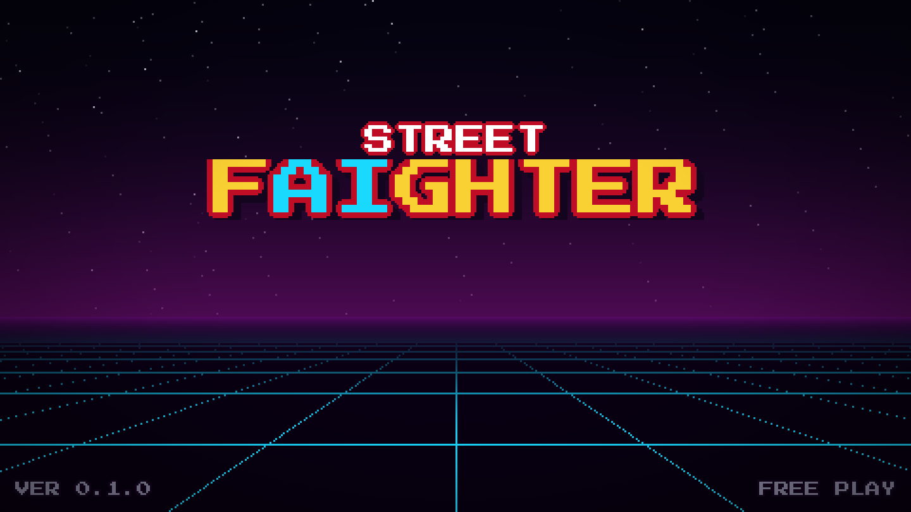
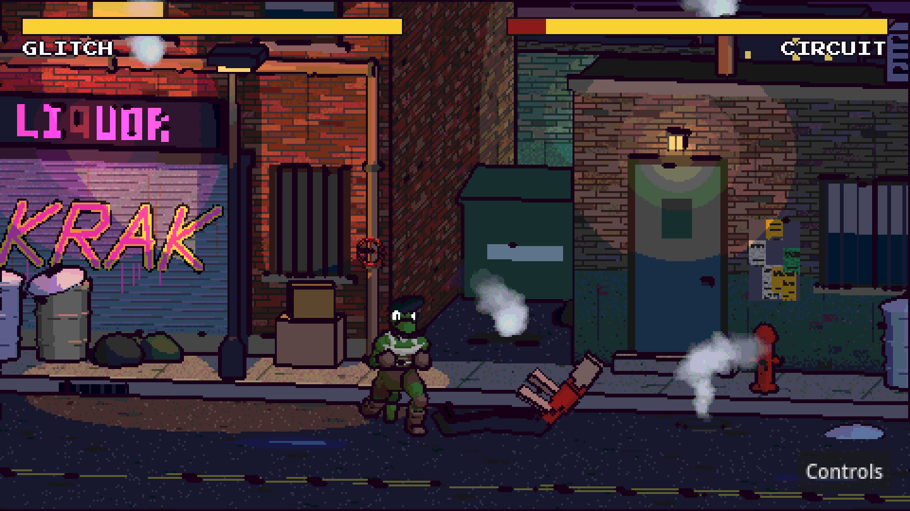
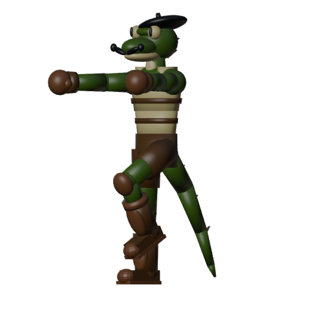
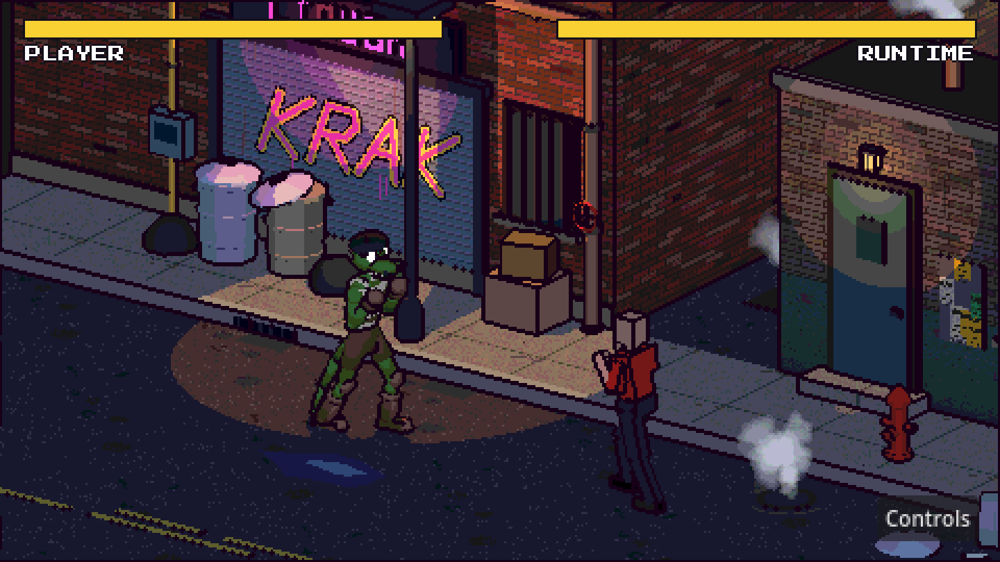

# Street fAIghter

**Bring your own AI. Build your own fighter.**

A pixel-art fighting game driven by real 3D models. Describe a fighter in a few words, let your AI coding agent (Claude Code, Codex, Gemini CLI, …) build it in Blender, then take it online against a friend.



**[Documentation & downloads →](https://dustinmichels.github.io/street-faighter/)**

## Features

- **Bring your own agent.** Answer a short questionnaire and the game writes a prompt kit; any agent that runs shell commands builds the fighter in Blender and checks it with the game's validator.
- **Online, peer to peer.** Host or join by IP. Deterministic lockstep netcode keeps both machines frame-identical, and custom fighters are sent to your opponent automatically.
- **Fight the CPU.** Punch, block, duck, sweep, and land three clean hits to charge a special throw.
- **Pixel art from real 3D.** Every frame is rendered at 480×270 with toon shading, outlines, and color quantization.
- **Fair by design.** Custom characters are cosmetic: hitboxes and damage are the same for everyone.



## One idea in, one fighter out

Jim Bean, *a french lizard man* in a beret, built by an AI agent from a seven-line brief:

| The agent's Blender preview render                          | The same model in game                                        |
| ----------------------------------------------------------- | ------------------------------------------------------------- |
|  |  |

In game: **CHARACTERS → CREATE NEW**, hand the kit to your agent, then **IMPORT** the result. See [Make your own fighter](docs/guide/custom-characters.md).

## Quick start from source

Requires [Godot](https://godotengine.org/download) 4.7 (standard build, not .NET). [mise](https://mise.jdx.dev) is optional.

```sh
git clone https://github.com/dustinmichels/street-faighter.git
cd street-faighter
godot --path .                                          # play
mise run mp                                             # two connected instances side by side
godot --headless --path . -s tests/determinism_test.gd  # run a test (see tests/)
```

## Docs

| Players                                                  | Developers                                                   |
| -------------------------------------------------------- | ------------------------------------------------------------ |
| [Download & install](docs/guide/download.md)             | [Run from source](docs/dev/index.md)                         |
| [How to play](docs/guide/playing.md)                     | [Tests](docs/dev/testing.md)                                 |
| [Online multiplayer](docs/guide/online.md)               | [Netcode](docs/dev/netcode.md)                               |
| [Make your own fighter](docs/guide/custom-characters.md) | [Custom character pipeline](docs/dev/custom-characters.md)   |
| [Troubleshooting](docs/guide/troubleshooting.md)         | [Skeleton reference](creator_kit/SKELETON.md)                |

The [docs site](https://dustinmichels.github.io/street-faighter/) is built with VitePress from [`docs/`](docs/) and deploys to GitHub Pages on every push to `main` that touches `docs/`. Preview locally with `mise run docs`. Plans and progress logs live in [`docs-todo/`](docs-todo/).
